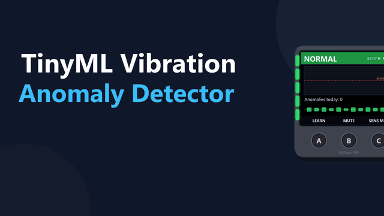

# M5Stack Fire TinyML Vibration Anomaly Detector

[](https://github.com/jadenchua-dot/m5stack-tinyml-vibration/actions/workflows/build.yml)
[](https://github.com/jadenchua-dot/m5stack-tinyml-vibration/releases/tag/latest)

The **M5Stack Fire** sits on a machine (a fan, pump, motor or washing machine) and learns what its *normal* vibration looks like. It then flags anything unusual: the screen and side LED bars turn **red** and it beeps.

The machine learning runs **entirely on the device**. A small neural network (an autoencoder) is trained on the ESP32 itself in about 3 seconds. There's no Wi‑Fi, no cloud and no laptop involved after flashing.

## 🎥 How to use it (animation)



▶️ **[Watch the full video (MP4)](docs/how-to-use.mp4)**

---

## Problem

Motors, pumps, fans and compressors rarely fail out of nowhere. Before a bearing wears out, a blade cracks or a mount loosens, the machine starts to **vibrate differently**. The trouble is:

- nobody stands next to the machine listening for it,
- a simple "vibration too high" limit misses changes in *how* it vibrates (a new rattle at a different frequency), and gives false alarms on machines that are always shaky,
- cloud-based monitoring needs Wi‑Fi, accounts and a subscription, which a workshop, plant room or farm shed often doesn't have.

**How might we** notice that a machine is behaving abnormally, early, with a cheap device that works anywhere, even without internet?

## Solution

Stick the Fire on the machine, press **LEARN** once while it runs normally, and leave it:

| Need | How this project meets it |
|---|---|
| Works on *any* machine | It learns that machine's own normal vibration, so there's no limit to look up or tune by hand. |
| Catches *new kinds* of vibration, not just "more" | It looks at 12 frequency bands, vibration on each axis and knocks/spikes, and alarms when the overall pattern changes. A machine that suddenly goes quiet (it **stops**) also looks different, so it is flagged too. |
| No internet needed | Training and detection both run on the ESP32. The model is saved in flash and survives power‑off. |
| Says what changed | The alarm screen names what changed most, e.g. *"Changed most: 26‑34 Hz band"*. |
| Few false alarms | It must be over the limit for 3 windows in a row (~1 s), and it ignores the moments when its own beeper or buttons shake the case. |
| Easy to adjust | **Sensitivity LOW / MED / HIGH** on one button, with no retraining. |

---

## Features

| | |
|---|---|
| **On-device training** | 30 s of normal vibration → 16 features per window → autoencoder (16‑8‑4‑8‑16) trained with Adam on the ESP32 in ~3 s |
| **Live anomaly score** | Every ~0.3 s. 1.0 = alarm limit. Scrolling graph on screen |
| **3 states** | 🟢 NORMAL · 🟠 CAREFUL (smoothed score ≥ 0.6) · 🔴 ANOMALY! (score ≥ 1.0 for 3 windows in a row) |
| **Explanation** | Shows which feature changed most (a frequency band, an axis, or knocks/spikes) |
| **Spectrum view** | 12 bars showing how each frequency band compares with normal (up = stronger, down = weaker) |
| **Alarm outputs** | Flashing red screen and LED bars, beep every 2 s (mutable) |
| **Saved model** | Model, sensitivity and mute are stored in flash (NVS) |
| **Serial plotter** | Prints `score:… limit:1.000` per window, so the Arduino/PlatformIO serial plotter graphs it live |
| **Auto-built firmware** | GitHub Actions builds every push and publishes ready-to-flash files to the [`latest` release](https://github.com/jadenchua-dot/m5stack-tinyml-vibration/releases/tag/latest) |

### Buttons (below the screen)

| A (left) | B (middle) | C (right) |
|---|---|---|
| **LEARN**: record normal vibration and train (press again to **CANCEL**) | **MUTE / UNMUTE** the beeper | **SENS**: cycle LOW / MED / HIGH |

### Serial commands (115200 baud)

`l` learn / cancel · `m` mute · `s` sensitivity · `i` model info

---

## How to use it

1. **Mount** the Fire firmly on the machine (double-sided tape, a clamp or a magnet base). A loose mount rattles and looks like an anomaly.
2. **Run the machine normally.** If it has several normal modes (e.g. fan speeds), run it through them while learning.
3. **Press A (LEARN).** A 3 s *GET READY* countdown lets you take your hand away, then it records for 30 s (LED bars fill up blue). Don't touch it.
4. **Training** takes about 3 s (purple). Then it shows **NORMAL** (green) and starts watching.
5. If the vibration changes, it goes **CAREFUL** (amber) and then **ANOMALY!** (red, beeping), showing what changed most. When the machine is back to normal it turns green again by itself.
6. Too many false alarms? Press **C** to lower the sensitivity. Moved it to another machine or changed the mounting? Press **A** to learn again.

---

## How it works

```
 MPU6886 accelerometer (≈220 Hz, 3 axes)
        │  128-sample windows, 50% overlap (one every ≈0.3 s)
        ▼
 Features (16):  vibration level X/Y/Z  ·  crest factor ("spikiness")  ·  12 FFT band energies (log)
        │  normalised with the mean/std of the normal data
        ▼
 Autoencoder  16 → 8 → 4 → 8 → 16   (tanh, trained on-device with Adam)
        │
        ▼
 Reconstruction error  ÷  alarm limit  =  anomaly score   ──►  screen · LED bars · beeper
```

- **Why an autoencoder?** It only ever sees *normal* data, so you never need examples of failures. It learns to squeeze a normal window through a 4-number bottleneck and rebuild it. Normal windows rebuild well. Anything unusual rebuilds badly, and that error is the anomaly score.
- **Features:** each axis has gravity removed, then a Hann window and a 128-point FFT. The three axes' power spectra are added together and grouped into 12 roughly log-spaced bands (≈2‑110 Hz at the measured sample rate). Everything is converted to log10, so a doubling counts the same whether the machine is quiet or loud.
- **Alarm limit:** every 4th recorded window is held back from training. The limit is set from the reconstruction error on those unseen windows: `max(mean + K·std, F·max)`, with K/F = 6/1.5 (LOW), 4/1.2 (MED) and 2.5/1.0 (HIGH). Changing sensitivity just picks a different K/F, so no retraining is needed.
- **Sampling** runs in its own FreeRTOS task on core 0, polling the IMU's data-ready flag every 1 ms, so the sensor's own clock spaces the samples evenly. The accelerometer's low-pass filter is set to ~99 Hz so very little above the Nyquist limit (≈110 Hz) folds back in.
- **Self-noise:** the Fire's speaker and button presses shake the case too, so windows that overlap them are shown but not counted towards the alarm.

### Measured on the device

| | |
|---|---|
| IMU sample rate | ≈219 Hz (measured; the band labels use the measured rate) |
| Windows recorded in 30 s | 99 (75 to train, 24 held back) |
| Training time (200 epochs) | 3.2 s on the ESP32 |
| Anomaly score while sitting still | 0.05‑0.34 (limit = 1.0) |
| Score when moved/handled | up to ≈93 → alarm |
| Model size | 356 weights (≈1.4 KB) + normalisation, stored in NVS |
| Flash / RAM used | 581 KB / 46 KB |

---

## Install

### Option A: flash the latest automatic build (no tools needed except Python)

Every push to `main` is built by GitHub Actions and published as the [`latest` release](https://github.com/jadenchua-dot/m5stack-tinyml-vibration/releases/tag/latest).

```powershell
powershell -ExecutionPolicy Bypass -File tools\flash-latest.ps1 -Port COM5
```

This downloads `tinyml-vibration-factory.bin` and flashes it at `0x0` (a fresh install, which also clears any learned model). Add `-KeepModel` to flash only the app (`tinyml-vibration-app.bin` at `0x10000`) and keep the learned model and settings.

### Option B: build it yourself with PlatformIO

1. Install [PlatformIO](https://platformio.org/) (VS Code extension or CLI).
2. Plug in the Fire with a **data** USB‑C cable.
3. Build and flash:
   ```bash
   pio run -t upload
   pio device monitor        # optional: watch the scores
   ```

Tuning (learn time, epochs, alarm/clear windows, warn level, volume, LED brightness) is in [`include/config.h`](include/config.h).

## Project layout

| File | What it does |
|---|---|
| [`src/ml.cpp`](src/ml.cpp), [`src/ml.h`](src/ml.h) | FFT, feature extraction, autoencoder, on-device training (Adam), scoring and alarm limit |
| [`src/main.cpp`](src/main.cpp) | Sampling task, state machine (learn → train → monitor), screen, LED bars, beeper, buttons, NVS storage |
| [`include/config.h`](include/config.h) | Tuning values |
| [`.github/workflows/build.yml`](.github/workflows/build.yml) | Builds every push, publishes the `latest` release |
| [`tools/flash-latest.ps1`](tools/flash-latest.ps1) | Downloads and flashes the latest build |
| [`docs/`](docs) | How-to-use animation (MP4 + GIF) |

## Design notes

- **The sample rate isn't the nominal 250 Hz.** The MPU6886 is set to 1 kHz ÷ 4, but the device measured ≈219 Hz. Rather than assume, the firmware measures the real rate every second and uses it for the Hz labels on screen.
- **The alarm must not trigger itself.** Beeping vibrates the case, which could hold the alarm on forever. Windows that overlap a beep or a button press are skipped for the alarm decision.
- **Quiet machines.** On a very still machine some features hardly change, and dividing by a tiny standard deviation would make noise look huge. Each feature's spread is floored at 0.05 (log10, ≈12%).

---

Built by Jaden Chua · Electronic and Computer Engineering, Nanyang Polytechnic
